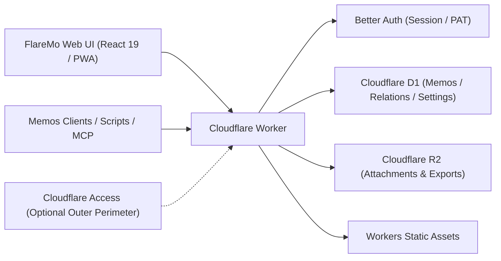

# FlareMo 🔥

<p align="center">
  <b>Zero Servers · Zero Upkeep · 24/7 Global Edge Uptime · Absolute Data Ownership</b><br>
  For individuals: a quiet, focused thought capture space and second brain. For teams: a shared space to publish notes to each other, with fine-grained roles.
</p>

<p align="center">
  <a href="./README.md"><b>English</b></a> •
  <a href="./README.zh-CN.md">简体中文</a> •
  <a href="./README.ja.md">日本語</a> •
  <a href="./README.fr.md">Français</a> •
  <a href="./README.es.md">Español</a> •
  <a href="./README.ko.md">한국어</a> •
  <a href="./README.ru.md">Русский</a> •
  <a href="./README.ar.md">العربية</a>
</p>

<p align="center">
  <a href="https://github.com/realchendahuang/FlareMo/stargazers"></a>
  <a href="./LICENSE"></a>
  <a href="https://workers.cloudflare.com/"></a>
  <a href="https://github.com/usememos/memos"></a>
  <a href="https://www.better-auth.com/"></a>
  <a href="https://flaremo.app"></a>
</p>

<div align="center">

| ☀️ Desktop · Light Theme | 🌙 Desktop · Dark Theme | 📱 Mobile · Responsive |
| :---: | :---: | :---: |
|  |  |  |

| ✅ To-dos, projects and review | 📄 Articles you can publish |
| :---: | :---: |
|  |  |

<sub>Actual live screenshots: seamless light/dark mode switching and full-featured mobile responsiveness. Every feature shown is wired to working backend capabilities.</sub>

</div>

---

## 💡 Why FlareMo?

Low-friction memo capture and a distraction-free timeline have proved their value. Self-hosting a traditional note-taking setup, though, typically means paying for a VPS, configuring Docker and PostgreSQL, scripting automated backups, and dreading disk or hardware failures.

FlareMo answers a simpler question: **Can you get a 24/7 online, resilient, globally accelerated knowledge base with zero server maintenance, using just a free Cloudflare account?**

- **Truly Serverless**: Both code and static assets run on Cloudflare Workers edge nodes near you with millisecond latency.
- **Enterprise-grade durability out of the box**: Cloudflare D1 handles notes and metadata; Cloudflare R2 stores media attachments with multi-region replication.
- **AI-Native Second Brain**: Agent Memory hub ships a CLI and a cross-agent skill so AI agents (Claude, Cursor, Codex, ChatGPT, ZCode) can read and update your long-term preferences and memory scopes; MCP endpoints are also available.
- **Quiet for one, powerful for many**: Default is an encrypted, private single-user sanctuary. Enable team mode to add a shared team space with roles and three-tier visibility — for sharing notes, not for running projects together.
- **Minimal, not simplistic**: The interface stays quiet and every control earns its place — nothing decorative shouting for attention, nothing useful missing.

---

## ✨ Key Features

### 1. Instant Capture & Inspiring Review
- **Capture in milliseconds**: Card-style timeline, tags, Markdown/GFM, and previews for image and audio attachments.
- **Notes and articles**: The composer stays a quick note (tags, up to 9 images, bold, lists, to-dos); "Write full screen" opens the same note in a full-screen canvas. Articles are written from the Articles page.
- **Comments under the note**: Comment on any note, in your personal space or the team space, Weibo-style. Comments live under the original note and stay out of the timeline, search, stats, tags, and review.
- **Lightning-fast search**: SQLite FTS5 full-text indexing with query operators (`has:attachment`, `is:pinned`, `before:YYYY-MM-DD`, `after:YYYY-MM-DD`, `in:timeline|archive|trash`).
- **Semantic "Find" (Vector Search)**: Workers AI embeddings paired with Vectorize derived vector indexes for contextual recall; re-verifies permissions against D1 and seamlessly falls back to FTS5.
- **Thought activation**: Built-in **Daily Review** (on this day), **Random Walk** (wandering through tag and backlink graphs with postcard summaries), and related note recommendations.
- **Revision history**: Full version diffs and one-click historical restore.

### 2. AI Long-term Memory (CLI + Skills)
- **Agent Memory**: Ships `flaremo` CLI and the `flaremo-memory` skill — agents record and update cross-session long-term memory (preferences, project decisions, constraints, lessons) through a shared REST base.
- **Human in the loop**: Review, verify, lock, or correct AI-recorded memories at `/memory`.
- **Open ecosystem**: CLI + Skills are the recommended path; `/memory/mcp` (Streamable HTTP MCP) and `/mcp` endpoints are available for existing MCP clients.

### 3. To-dos & Projects
- **Schedule a note**: Pick a day and a project for a note; each unchecked to-do in it becomes a task. Checking it off in the note or on the to-do page stays in sync both ways.
- **One to-do page**: `/projects` shows **Today**, **Next 7 days**, and **All tasks** as day-grouped lists, plus your projects as kanban boards (drag between status columns, priorities, manual order). Every list has a quick-add row.
- **Personal by design, reversible deletion**: Tasks belong to a single owner; deleting moves them to a recycle bin until restored or automatically purged.

### 4. Reminders & Time Horizons
- **Badges where you read**: Scheduled notes show "to-dos n/m · date · project" on the card, and Daily Review opens with today's to-dos.
- **Time horizons at a glance**: The explorer home view pairs a mini month calendar with overdue/today reminders, so what's due never hides behind the board.
- **Due and overdue reminders**: A daily job raises "due today" and overdue notifications in the app, with optional browser Web Push. Schedules are day-level; there are no clock-time alarms.

### 5. Team Space & 3-Tier Visibility
- **Sharing, not collaboration**: The team space is where members publish notes to each other and comment on them. `@username` mentions autocomplete in the team composer and notify the person mentioned; notifications open the original note at its comments.
- **Role governance**: `owner`, `admin`, and `member` roles. Admins invite members via one-time activation links (members choose their own passwords; admins never handle plaintext credentials).
- **3-tier visibility**:
  - 🔒 **Private**: Only author can view.
  - 👥 **Team**: Shared read-only with active team members.
  - 🌐 **Public**: Anonymous read-only via time-limited share links.
- **Safe offboarding**: Removing a member triggers reliable background cleanup that purges private data while preserving team and public notes.
- **Reader seats**: Grant a time-boxed read-only seat — guest readers, course cohorts, client delivery. Seats lapse automatically at their expiry (fail-closed at credential resolution, no cron needed). Manage them from the members page, or provision by email through `PUT /api/app/admin/team/reader` with a Personal Access Token (see `docs/team-mode.md`).

### 6. Offline First & PWA Experience
- **Installable PWA**: Install to macOS, Windows, iOS, or Android home screen with native feel.
- **Reliable offline sync**: Drafts save locally instantly. Offline submissions and uploads queue up and replay automatically when connectivity is restored.
- **Live voice input**: The composer's microphone button streams speech-to-text (ASR) into the draft as you speak.

### 7. Secure Better Auth Application Security
- **Better Auth powered**: HttpOnly, `SameSite=Lax` browser cookie sessions; revocable `memos_pat_` Personal Access Tokens for scripts, CLI, and MCP.
- **Strict Origin protection**: State-changing requests enforce exact origin whitelisting. Cloudflare Access remains available as an optional outer defensive perimeter.

### 8. Memos Compatibility & Seamless Migration
- **Memos `/api/v1` compatibility**: Provides core Memos API endpoints (camelCase default, legacy snake_case via header) and OpenAPI schema.
- **Third-party apps ready**: Works directly with mobile clients like Moe Memos.
- **Bi-directional import & export**: Full raw export bundles, one-click import with conflict strategies, plus a converter for Memos 0.31 exports ([guide](./docs/en/import-from-memos.md)).

---

### 9. Plugin System: Cards as Plugins
- **Five built-in cards**: Plain, Daily, Ticket, Postcard, plus a canvas-drawn Postmark demo.
- **Store and curation**: browse directories, one-click install (SHA-256 verified), enable/disable, reorder, set the default, hide — all in account settings. The official directory lives at [flaremo.app/plugins](https://flaremo.app/plugins/registry.json).
- **Upload your own**: admins can install a local package — it exists only on that instance and is never sent anywhere.
- **Authoring tools**: `pnpm plugin:new` scaffolds, `pnpm plugin:check` validates with the **exact rules instances enforce on install**, `pnpm plugins:build` packages. Document cards are pure JSON layouts; sandbox cards run your own HTML/CSS/JS. See the [plugin guide](./docs/en/plugins.md).
- **Safe by default**: cards run in an opaque-origin sandbox with **no network access**; community and brand packs stay off until an admin enables them.

## 📊 How Generous Is Cloudflare's Free Tier?

Many assume "free" means "severely limited". For text-heavy personal knowledge bases, Cloudflare's free quota is virtually inexhaustible:

| Resource | Free Tier Quota | Equivalent Capacity | Practical Lifespan |
| :--- | :--- | :--- | :--- |
| **Cloudflare D1** | **5 GB database** | ~**2.5 Million** text memos | Writing 100 memos daily would take **68 years** to fill |
| **Cloudflare R2** | **10 GB storage** | ~**5,000–10,000** photos / **80 hours** of voice | **$0 egress fees**; public sharing won't trigger bandwidth bills |
| **Cloudflare Workers** | Generous free request limits | 300+ global edge locations | Millisecond latency worldwide without cold boots |

---

## 🥊 Comparison: Cloudflare Native vs Home NAS vs Traditional VPS

| Dimension | Cloudflare Native (FlareMo) | Home NAS / Mini PC | Traditional VPS |
| :--- | :--- | :--- | :--- |
| **Data Durability** | **Enterprise multi-region replication**, zero hardware failure risk | Single drive failure or power outage can cause total data loss | Dependent on manual snapshot & backup routines |
| **Maintenance** | **Zero**: No OS patching, no Docker compose, no DB maintenance | OS updates, Docker upkeep, SMART disk alerts, router configs | Kernel upgrades, security patches, watchdog daemons |
| **Access Latency** | **Global edge CDN**, sub-100ms response anywhere | Requires DDNS / frp / Tailscale tunnels, constrained by home uplink | Dependent on single cloud region; high cross-border latency |
| **SSL & Domains** | **Automated HTTPS** & custom domain bindings | Manual certificate issuance, reverse proxy configuration | Nginx / Caddy config & Let's Encrypt renewal maintenance |
| **Financial Cost** | **$0 / month** on free tier | High upfront hardware cost + ongoing electricity | Ongoing monthly / annual server & bandwidth bills |

---

## 🚀 5-Minute Quick Deployment

### Method 1: One-click Deploy to Cloudflare

[](https://deploy.workers.cloudflare.com/?url=https://github.com/realchendahuang/FlareMo)

Clones the repository into your GitHub account and provisions D1, R2, Queues, and Vectorize automatically. After the initial deploy, set `FLAREMO_PUBLIC_URL` and secrets (see [docs/en/deploy.md](./docs/en/deploy.md#one-click-deploy-community-supported)). If the first attempt reports "Github API Limit Exceeded", wait a few minutes and retry.

### Method 2: GitHub Action (self-hosted fork)

On your fork, run **Deploy to Cloudflare** from Actions to provision resources, publish the Worker, and sync auth secrets. Pushes do not publish. See [docs/en/github-action-deploy.md](./docs/en/github-action-deploy.md).

### Method 3: Deploy with an AI Agent (Recommended)

Give the repository to an agent capable of executing terminal commands (e.g. Claude Code, Cursor Agent, Codex) along with [docs/en/agent-deploy.md](./docs/en/agent-deploy.md):
> "Please deploy FlareMo to my Cloudflare account following docs/en/agent-deploy.md."

---

### Method 4: Manual 3-Step Deployment

#### 1. Create Cloudflare Resources
```bash
pnpm exec wrangler whoami
pnpm exec wrangler d1 create flaremo
pnpm exec wrangler r2 bucket create flaremo-attachments
```

Or run `pnpm provision:remote` instead: it creates the missing D1 / R2 / Queue / Vectorize resources and writes the D1 `database_id` into `wrangler.jsonc` for you. It is idempotent — existing resources are skipped.

#### 2. Configure Settings & Secrets
```bash
cp wrangler.jsonc.example wrangler.jsonc
```
Fill in the generated `database_id` and set `FLAREMO_PUBLIC_URL` to your production domain. Then set secrets:
```bash
pnpm exec wrangler secret put BETTER_AUTH_SECRET --config ./wrangler.jsonc
pnpm exec wrangler secret put FLAREMO_BOOTSTRAP_SECRET --config ./wrangler.jsonc
```

#### 3. Deploy
```bash
pnpm deploy:dry-run
pnpm deploy
```

(The full `pnpm verify` gate runs only when the maintainer explicitly asks for it.)
Visit your production domain at `/setup` and enter the `FLAREMO_BOOTSTRAP_SECRET` to initialize your Owner account.

Detailed guides: [Deployment Guide](./docs/en/deploy.md) · [GitHub Action deploy](./docs/en/github-action-deploy.md) · [Update Guide](./docs/en/update.md).

---

## 🧱 Architecture & Tech Stack



- **Runtime**: Cloudflare Workers
- **Frontend**: React 19, Vite, TanStack Router, Tailwind CSS 4, Radix UI
- **Database**: Cloudflare D1, Drizzle ORM
- **Storage**: Cloudflare R2
- **Auth**: Better Auth (HttpOnly cookie session + revocable `memos_pat_`)
- **AI & Search**: Workers AI, Vectorize, SQLite FTS5
- **Plugins**: slot-based extension platform ([standard](./docs/plugin-platform-standard.md), [guide](./docs/en/plugins.md)); packages live in R2, sandboxed cards run without network access

---

## 🌟 Star History

[](https://star-history.com/#realchendahuang/FlareMo&Date)

---

## 📄 License

Open-sourced under the [GNU AGPL-3.0](./LICENSE) license.
Copyright (c) 2026 realchendahuang.
